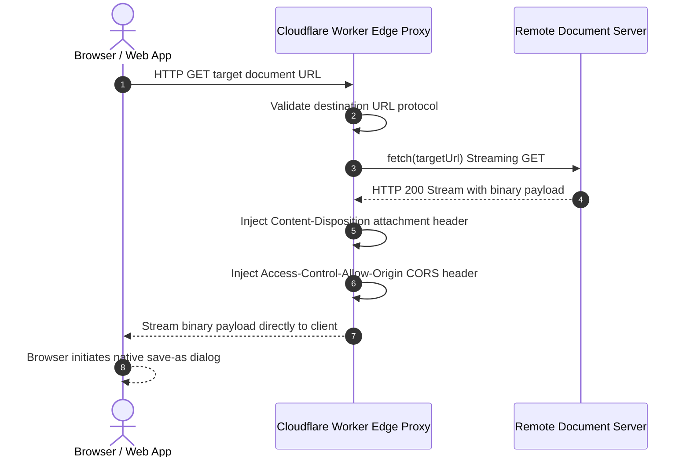

<div align="center">
  <h1>pdf-download-proxy</h1>
  <p>Cloudflare Worker edge reverse proxy for cross-origin document streaming and forced binary attachment downloads.</p>

  <p>
    <a href="https://github.com/itsgoharrehman/pdf-download-proxy/releases"></a>
    <a href="LICENSE"></a>
    
    
    
    <a href="https://github.com/itsgoharrehman/pdf-download-proxy/stargazers"></a>
    <a href="https://github.com/itsgoharrehman/pdf-download-proxy/issues"></a>
  </p>
</div>

---

A high-performance Cloudflare Worker reverse proxy engineered to resolve browser cross-origin resource sharing (CORS) constraints and force direct binary attachment downloads for PDF documents and external assets.

By rewriting HTTP headers at the edge, the proxy streams binary file chunks directly from source servers to the client without buffering payloads in worker memory, ensuring zero file-size limitations and low latency.

---

## Architectural Workflow



---

## Key Capabilities

* **Forced Binary Downloads**: Injects standard `Content-Disposition: attachment; filename="..."` headers, preventing browsers from forcefully hijacking PDFs into internal previewers.
* **Zero-Buffer Stream Piping**: Pipes readable binary streams directly to the client response, preventing worker memory exhaustion regardless of file size.
* **CORS Header Management**: Automatically handles preflight `OPTIONS` requests and attaches permissive or domain-locked CORS headers.
* **Edge Anycast Deployment**: Executes within Cloudflare's global edge network, minimizing round-trip time between clients and storage origins.

---

## API Specification

### Endpoint: `GET /`

#### Query Parameters

| Parameter | Type | Required | Description |
| :--- | :--- | :--- | :--- |
| `url` | `string` | Yes | Encoded HTTPS destination URL of the target document |
| `filename` | `string` | No | Custom attachment filename suggested to the browser |

#### Example Request

```bash
curl -I "https://pdf-proxy.workers.dev/?url=https%3A%2F%2Fexample.com%2Freport.pdf&filename=AnnualReport2026.pdf"
```

#### Response Headers

```http
HTTP/2 200
access-control-allow-origin: *
content-disposition: attachment; filename="AnnualReport2026.pdf"
content-type: application/pdf
```

---

## Directory Structure

```
pdf-download-proxy/
├── .github/
│   ├── ISSUE_TEMPLATE/
│   │   ├── bug_report.yml          # Structured defect report form
│   │   └── feature_request.yml     # Structured feature request form
│   ├── PULL_REQUEST_TEMPLATE.md    # Pull request review checklist
│   └── dependabot.yml              # Weekly automated npm dependency scanner
├── worker.js                       # Core streaming proxy logic
├── wrangler.jsonc                  # Cloudflare Worker deployment configuration
├── package.json                    # Project tooling scripts and metadata
├── LICENSE                         # MIT License
├── SECURITY.md                     # Security policy and SSRF prevention
├── CONTRIBUTING.md                 # Contribution guidelines
└── CODE_OF_CONDUCT.md             # Contributor Covenant v2.1
```

---

## Local Development and Deployment

### Prerequisites
* Node.js v18+
* Cloudflare account with Wrangler CLI configured

### Setup and Running Locally
1. Clone the repository:
   ```bash
   git clone https://github.com/itsgoharrehman/pdf-download-proxy.git
   cd pdf-download-proxy
   ```

2. Install development tooling:
   ```bash
   npm install
   ```

3. Start the local development server:
   ```bash
   npm run dev
   ```

4. Deploy to Cloudflare Workers:
   ```bash
   npm run deploy
   ```

---

## Security Policy

* **Target URL Safety**: See [SECURITY.md](SECURITY.md) for SSRF protection and open proxy mitigation guidelines.
* **Disclosure**: Report vulnerabilities via private email to goharrehmanfsd260@gmail.com.

---

## License

This project is licensed under the [MIT License](LICENSE).
